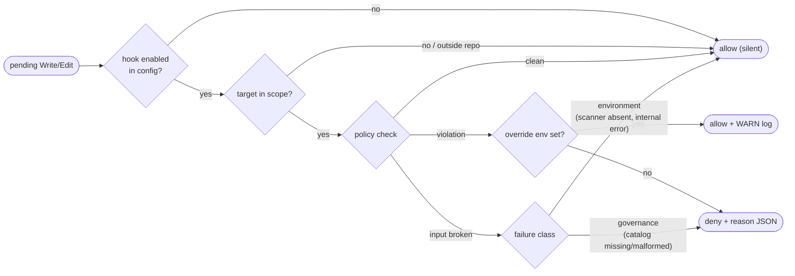
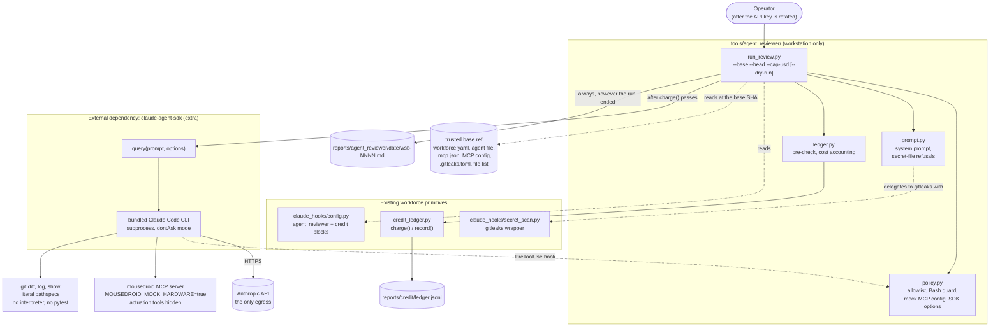

# C4 Component — Claude Code Workforce Governance (F-024)

> The edit-time governance chain that runs *before* a Write/Edit reaches disk in
> a Claude Code session, plus the CI gates that keep the chain itself honest.
> Added under F-024 to close two gaps the repository had carried as prose: the
> secret-scan gate existed only in CI (advisory, post-commit), and the "hardware
> readiness preempts all in-flight software streams" freeze rule was enforced by
> plan text plus one substring test — nothing stopped a capability edit at the
> moment it was made.
>
> Companion to `docs/architecture/c4-overview.md` (Levels 1–2),
> `docs/runbooks/claude-workforce-hooks.md` (operator workflow), and
> `docs/runbooks/secret-scanning.md` (the CI-side secret gate this reuses).
>
> **Scope:** developer tooling only. Nothing here runs on the rover, and
> `tools/claude_hooks/` never imports the `mousedroid` runtime package — an
> edit must not pay a torch/faiss/lmdb import cost.

## Component Diagram

```mermaid
flowchart TB
    subgraph Session["Claude Code session"]
        Agent(["Agent / operator"])
        Tool["Write / Edit / MultiEdit / NotebookEdit"]
    end

    subgraph Settings["Hook wiring (.claude/settings.json)"]
        Pre["PreToolUse matcher\nWrite|Edit|MultiEdit|NotebookEdit\n(blocking)"]
        Post["PostToolUse matcher\nWrite|Edit|MultiEdit\n(report-only)"]
    end

    subgraph Hooks["Hooks (tools/claude_hooks/)"]
        Secret["secret_scan.py\nscan pending buffer"]
        Freeze["freeze_gate.py\ncapability freeze"]
        PostEdit["post_edit_check.py\nruff + mypy on touched file"]
    end

    subgraph Primitives["Reusable primitives (policy-free)"]
        Config["config.py\nWorkforceConfig (pydantic, extra=forbid)"]
        Paths["paths.py\nrepo root + glob (no separator crossing)"]
        HookIO["hookio.py\nstdin payload / stdout decision"]
        Logging["logging_setup.py\nstructured logs -> STDERR"]
        Portability["portability.py\nabsolute-path rule"]
    end

    subgraph Inputs["Governance inputs (repo-native)"]
        WorkforceYaml[("`.claude/workforce.yaml`\nthresholds, globs, gate keys")]
        Features[("`features.yaml`\nF-008 gate feature")]
        Gitleaks[("`.gitleaks.toml`\nregex-only allowlist")]
    end

    subgraph Gates["CI gates (scripts/ci.sh + ci.yml)"]
        AQA["tests/regression/\ntest_claude_workforce_aqa.py\n(PR gate)"]
        Units["tests/unit/tools/claude_hooks/\n--cov + --cov-branch"]
        TypeCheck["mypy --strict\ntools/claude_hooks/"]
        Lint["ruff check/format\nsrc/ tests/ tools/"]
    end

    Agent --> Tool
    Tool --> Pre
    Tool --> Post
    Pre --> Secret
    Pre --> Freeze
    Post --> PostEdit

    Secret --> HookIO
    Freeze --> HookIO
    PostEdit --> HookIO
    Secret --> Config
    Freeze --> Config
    PostEdit --> Config
    Freeze --> Paths
    Secret --> Logging
    Freeze --> Logging
    PostEdit --> Logging

    Config -.reads.-> WorkforceYaml
    Freeze -.reads.-> Features
    Secret -.delegates to gitleaks with.-> Gitleaks

    Secret -->|deny / allow| Tool
    Freeze -->|deny / allow| Tool
    PostEdit -->|findings to stderr| Agent

    AQA -.validates.-> WorkforceYaml
    AQA -.validates.-> Settings
    AQA --> Portability
    Units --> Hooks
    TypeCheck --> Hooks
    Lint --> Hooks
```

## Decision flow

Both PreToolUse hooks run on every matching tool call and are independent — a
deny from either blocks the write.



**The split failure posture is deliberate.** A *governance* failure — an
unreadable or malformed `features.yaml`, or an absent gate feature — denies,
because the gate cannot prove the freeze has lifted and a broken governance
input is itself worth stopping on. An *environment* failure — a missing scanner
binary, an unexpected internal error — allows with a warning, because bricking
every edit in a session is worse than a missed gate. `secret_scan.strict: true`
moves the scanner-absent case into the deny column for operators who want it.

## Contracts

| Contract | Where | Why it is load-bearing |
|---|---|---|
| **stdout is the decision channel** | `hookio.py`, `logging_setup.py` | Claude Code parses hook stdout as JSON. All logging goes to **stderr**; a stray log line would corrupt the decision payload. |
| **Allow is silent** | `hookio.emit_allow` | Emitting an explicit `allow` *bypasses* the user's normal permission prompt. A hook with no objection writes nothing and exits 0. |
| **`bash $CLAUDE_PROJECT_DIR/tools/claude_hooks/run_hook.sh -m tools.claude_hooks.<mod>`** | `.claude/settings.json` | Two failures in one form. Running the module file by path leaves the repo root off `sys.path`, so the package import fails on *every* edit — hence `-m` plus the chdir. And a bare `python3` resolves by `PATH`, which on the project's containers is the system interpreter with no pydantic: the hook exited 1, which Claude Code treats as a non-blocking hook *error*, so every gate silently failed open. `run_hook.sh` resolves an interpreter by capability instead. Both halves pinned by the AQA test (`test_wired_hook_commands_run_from_the_project_directory`, `test_wired_hook_commands_do_not_invoke_a_bare_interpreter`). |
| **No runtime import** | `tools/claude_hooks/**` | Importing `mousedroid` would drag torch/faiss/lmdb into the edit path. Pinned by `test_hook_package_has_no_runtime_package_import`. |
| **Single config source** | `.claude/workforce.yaml` + `WorkforceConfig` | `extra="forbid"` turns a typo (`frozen_path`) into a load error instead of a silently disabled gate. Every field defaults, so a missing file still loads. |
| **Shared `.claude/` assets must be git-tracked** | `.gitignore` negations + AQA | `.gitignore` excludes `.claude/*`, so a new shared asset is untracked by default — present locally, absent in CI. This is how `workforce.yaml` first failed to ship. |
| **Local structlog binding** | `logging_setup.py` | Uses `wrap_logger`, not `structlog.configure()`, so importing a hook never mutates the process-global config the test suite pins. |
| **Gate self-disables** | `freeze_gate.py` | When F-008 reaches `done` the freeze lifts with no code change and no redeploy. |

## Agent-SDK peer reviewer (F-059 WS-B / WS-D)

`tools/agent_reviewer/` is the one component in this document that **spends money and
reaches a third party**: it drives the Claude Agent SDK to run an adversarial review of a
change set (`--base...--head`) and writes the review into the repository. It is workstation
tooling like everything else here - never on the rover, never imported by it - but it adds an
external dependency and an egress path, so its trust boundary is drawn explicitly.



**What is new.** `claude-agent-sdk` (the `agent_reviewer` extra: not in `[dev]`, not installed by
CI), the Claude Code CLI it bundles and spawns as a subprocess, and an HTTPS call to the
Anthropic API - the one egress. `anthropic` (the `anthropic` extra) is optional and only resolves
the model alias with `models.retrieve`; `gitleaks` is optional and only adds a scan of the
assembled prompt and of the review before it is saved.

**Threat model: the head may be hostile.** The reviewer runs with an API key in its environment
against a change set whose head commit controls every file in the working tree. So the trust boundary
is the **base** ref: nothing the head controls may reach an exec sink, a process that holds the key,
or the reviewer's own configuration and instructions. Everything the reviewer configures itself from
is therefore read from the base commit with `git cat-file blob <base-sha>:<path>` and `git ls-tree -r
<base-sha>`, never from the working tree: `.claude/workforce.yaml` (it selects the agent file, the MCP
declaration, the secret-scan program and its policy file, the caps, and where the review and the ledger
row are written), the reviewer's instructions (`.claude/agents/peer-reviewer.md`), the MCP declaration
(`.mcp.json`), the MCP server's configuration (`config/default.yaml`), the secret policy
(`.gitleaks.toml`) and the list of files `git show <commit>:<path>` may name. What the head does control
(the diff; what `Read` and `Grep` return) reaches the model as data, with no exec sink behind it. The one
exception is deliberate: the spend ledger is the history of past runs, so it is read from the checkout.

**Containment, in the order the SDK applies it.** Each layer is a pure function or a constant in
`policy.py` (or the runner's trust check), pinned by `tests/unit/tools/test_agent_reviewer.py` without
the SDK or a network:

| # | Layer | What it guarantees |
|---|---|---|
| 1 | `tools=` base set | The model is shown only `Read`, `Grep`, `Glob`, `Bash`: no `Write`, `Edit`, web or subagent tool exists for it. |
| 2 | PreToolUse hook `deny_non_readonly_bash` | Runs first. A whitelist: `git diff\|log\|show` as one plain command and nothing else - no interpreter and no `pytest` (`--collect-only` still imports the head's `conftest.py`, and an `@argfile` argument can inject options). Refuses the options that write a file (`--output`), run a program or read outside the repo (`--no-index`, `--ext-diff`, `--textconv`), widen the search to every ref (`--all`, `--reflog`, `--branches`, `--remotes`) or print blob ids (`--raw`, `--abbrev`); shell syntax; unquoted globs. Pathspecs follow `--` and are literal: none contains `* ? [ :` or starts with `-`. **A revision must be one of the two pinned commits** (the resolved base and head ids) with `^` / `~N` suffixes, alone or as `A..B`: a bare blob or tree id, an abbreviation, `HEAD` or a ref name could name an object whatever its path, so none is accepted, and an option's value is attached to it (`-n5`). `git show <commit>:<path>` is accepted only for a non-secret file tracked at the base ref. Silent when it has no objection, so it can only tighten. Fails closed. |
| 3 | `disallowed_tools` deny rules | Evaluated even if the hook failed: writes, web, subagents, every actuation tool by name (a superset of `MCPConfig.actuation_tools`, pinned by a test), and reads of `*.env`, `docker.env*` and credential directories. |
| 4 | `permission_mode="dontAsk"` | Anything not pre-approved is denied; a headless run has nobody to ask. |
| 5 | `allowed_tools` | The allowlist: the read tools, the three git patterns, and `system_info` / `lidar_diagnostics` / `esp32_diagnostics`. |
| 6 | MCP entry | Only the `mousedroid` server, **built in code** from constants: `sys.executable -I -c <fixed bootstrap> <config>` with a fixed minimal environment (`MOUSEDROID_MOCK_HARDWARE=true`, `MOUSEDROID_MCP__EXPOSE_ACTUATION_TOOLS=false`, every credential variable blanked). `-I` keeps the working directory and every `PYTHON*` variable off the import path on any Python; the bootstrap (the CLI's stdio schema has no `cwd`) changes to a scratch directory outside the checkout and then does what `python -m mousedroid --config <file>` does, with a copy of the BASE ref's `config/default.yaml`. Nothing is passed through from `.mcp.json`: the copy at the base ref only has to *confirm* the pinned command and arguments, and any mismatch raises - there is no fallback. `strict_mcp_config` so the CLI loads no other server (the `github` entry of `.mcp.json` carries a token and can write). |
| 7 | `setting_sources=[]` | No user, project or local settings file can widen any of the above, and the head's `.claude/settings.json` hooks never run. |
| 8 | Process environment (`process_env`) | The environment the reviewer adds for the CLI is an allowlist - `PATH`, `HOME`, `LANG` - plus forced constants (`GIT_LITERAL_PATHSPECS=1`, `GIT_OPTIONAL_LOCKS=0`, `MOUSEDROID_MOCK_HARDWARE=true`, `NoDefaultCurrentDirectoryInExePath=1`). No credential is copied into it, whatever the parent holds. The SDK lays it over the CLI's inherited environment, so it cannot remove the key the CLI itself needs: the key is kept from the head's code by never starting a process the head can steer (layers 2, 6, 9 and 10), not by scrubbing. |
| 9 | Whose code runs beside the key | Three pieces of code run in or beside the process that holds the key: the reviewer's own modules, the interpreter's environment (its `site-packages` and `.pth` files run at startup, even under `-I`) and the `mousedroid` package the MCP server imports (the checkout's own source under an editable install). Each is the head's when it lives inside the checkout under review and the checkout is not at the base commit. The plan prints where each comes from (`trust_controller`, `trust_interpreter`, `trust_package`) and the run is refused before any spend unless `--trust-checkout` accepts it. An interpreter environment inside the checkout in which the head *tracks* files (`git ls-tree` at the head, `git ls-files` for the index) is refused whatever the flag says. The safe setup keeps the three outside the checkout under review (see the README). |
| 10 | Program lookup | `git` and `gitleaks` are looked up in the absolute directories of `PATH` only (`policy.resolve_executable`). `shutil.which` and Windows' `CreateProcess` both look in the working directory first, so a `git.exe` committed to the head would run in the reviewer's own process, with the key in its environment. |

**Spend.** `--cap-usd` is both the amount `charge()` must find headroom for - it raises `CapExceeded`
before any client is built - and the SDK's `max_budget_usd`. The row's cost is
`ResultMessage.total_cost_usd`; when that is unknown the run is charged its cap rather than zero.
The artifact and the ledger row are written whether the run succeeded, failed, timed out or was
interrupted. `max_turns`, the model alias, the caps and the ledger path live in `.claude/workforce.yaml`, read
from the base ref.

**Why no `RegexInjectionFilter`.** That filter guards natural language leaving the *rover* toward an
actuation-bearing translation (CHARTER section 3). The reviewer holds no actuation or write tool,
runs against a mock-hardware MCP, and a human reads its output before merge; an injection in
repository text can at worst produce a wrong paragraph in an advisory review. The allowlist is the
control, not a text filter.

**Not claimed.** `Read` is not confined to the repository (the deny rules are a screen, not a
sandbox). The CLI that holds the API key keeps it in its own environment: the SDK merges the `env`
it is given over the inherited one, so credentials are withheld from child processes by what is
allowed to run, not by scrubbing. The CLI has a switch that strips credentials from its
subprocesses (`CLAUDE_CODE_SUBPROCESS_ENV_SCRUB`); it is not enabled, because it is tied to the
CLI's permission-mode handling and subprocess sandbox, which cannot be rehearsed without spending.
`git log -p` shows any secret ever committed in the pinned history. The base ref itself is trusted,
and so is the spend ledger's history: a hostile head can edit its rows, so the cumulative workstream
cap guards against the operator's own mistakes while the per-run `--cap-usd` (also the SDK's hard
stop) bounds each run. `git` runs with the operator's own configuration, so a diff or
text-conversion driver defined there and named by the head's `.gitattributes` would run. If the SDK
wheel lacks its bundled CLI the SDK searches `PATH` for `claude`. The aim is that a hostile head can
mislead a review and spend up to its cap, but gets no code execution and no process that holds the key.

## Why this shape

**Hooks carry policy only.** The five primitives (`config`, `paths`, `hookio`,
`logging_setup`, `portability`) are separately unit-tested and reused by the AQA
gate, so each hook module reads as a policy statement rather than a pile of
path-wrangling and subprocess plumbing.

**Glob matching is not `fnmatch`.** `fnmatch`'s `*` crosses directory
separators, which would make `src/mousedroid/*` silently freeze the whole tree.
`paths.glob_to_regex` gives `**` separator-crossing semantics and `*`/`?`
single-segment semantics, with a wildcard-free pattern matching exactly or as a
directory prefix.

**The AQA gate is a regression test, not a workflow.** The regression tier
already runs across the 3.10/3.11/3.12 matrix in the existing `test` job, so a
new workflow would add a startup surface to keep green and buy nothing. This
follows the precedent set by `tests/regression/test_skill_commands_aqa.py`.

**Coverage needed its own invocation.** The repository gate measures
`src/mousedroid` only (`[tool.coverage.run] source`), so `tools/` code would
have shipped with zero measured coverage in either direction. `scripts/ci.sh`
and the `local-gates` job in `ci.yml` run a dedicated
`--cov=tools/claude_hooks --cov-branch` stage whose line threshold is read
from `coverage.tools_line_min` — branch coverage is reported but advisory,
because no baseline exists and the repository does not claim metrics it does
not enforce.

**Cross-platform path validation.** `Path.is_absolute()` is
platform-dependent: `/etc/features.yaml` is absolute on Unix but not on
Windows (no drive letter). The security validators in `FreezeConfig` and
`SecretScanConfig` therefore check *both* `Path(value).is_absolute()` and
`PurePosixPath(value).is_absolute()`, catching Unix-style absolute paths
regardless of the host OS. The AQA gate
(`tests/regression/test_cross_platform_portability_aqa.py`) pins this
invariant.

**Cross-platform test stubs.** The stub-scanner tests create tiny
executables to stand in for `gitleaks`. On Unix these are shebang scripts;
on Windows, `shutil.which` requires a `.cmd`/`.exe` extension.
`_make_stub(bindir, name, body)` in `test_secret_scan.py` abstracts the
difference, writing `.cmd` batch wrappers on Windows and `#!` shebang
scripts on Unix. The AQA gate verifies the helper exists and branches on
`sys.platform`.

## Related

- Root `CLAUDE.md` Surface Map — indexes all 17 in-package `CLAUDE.md` subsystem contracts (F-053 / WS-8d)
- `docs/claude/surfaces/README.md` — operational surfaces index, including the package import map
- `docs/architecture/package-map.md` — generated package import map (not dataflow; F-053 Phase 5)
- `docs/runbooks/claude-workforce-hooks.md` — operator guide, debugging, overrides
- `docs/runbooks/worktrees.md` — git worktrees for parallel agent isolation (D-6)
- `docs/runbooks/secret-scanning.md` — the CI-side gitleaks gate (F-015)
- `docs/architecture/ADR-013-f-number-namespaces.md` — F-number allocation
- `openspec/changes/mouse-droid-claude-workforce/` — the change bundle and its peer review
- `tools/agent_reviewer/README.md` — what the Agent-SDK reviewer may touch, what it never does, how to run the first review
- `tests/unit/tools/test_agent_reviewer.py` — the reviewer's containment pins (allowlist, Bash guard, MCP config, ledger)
- `tests/regression/test_cross_platform_portability_aqa.py` — portability invariant pins
